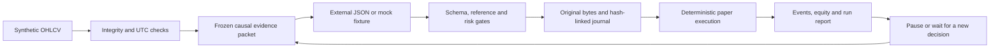

# Crypto Agent — Auditable AI Research & Paper-Trading System

**An auditable AI-assisted market research and paper-trading system featuring decision freezing, deterministic simulation, and reproducible offline demos.**

[中文说明](README.zh-CN.md) · [Capability boundaries](docs/CAPABILITIES.md) · [Verification](docs/VERIFICATION.md) · [Security](docs/SECURITY.md)

> **This public candidate is a sanitized, fully offline engineering demo. Both prices and model answers are synthetic fixtures. It performs no live AI inference, connects to no funded account, and provides no evidence of trading profitability or autonomous research.**

## Overview

Crypto Agent began with a practical market-research need: turn model-generated market opinions into a workflow that can be traced, checked, simulated, and reviewed. This repository exposes a small, reproducible subset of that infrastructure, rather than the complete private research project.

Suggested repository name: `crypto-agent-auditable-demo`. The Python distribution remains `auditable-research-demo`; the CLI is `research-demo`.

## Problem & Motivation

A plausible market narrative is not an executable, trustworthy plan. A research workflow must establish what data was available, preserve the original answer, reject ambiguous or excessive-risk orders, and explain what happened after execution or interruption.

The demo therefore separates **evidence → imported decision → admission → frozen record → deterministic simulation → feedback**. It does not attempt to prove that a model can predict markets.

## Key Features

| Feature | Evidence in this repository |
| --- | --- |
| Causal market input | Validated synthetic 15m OHLCV, aggregated into closed 1h/4h/1d candles from the visible prefix |
| Traceable decisions | Request hashes, evidence IDs, exact imported bytes, UTC timestamps, runtime fingerprints and append-only hash-linked records |
| Explicit admission | JSON Schema, input binding, valid brackets, fixed quantity, collateral and cost-inclusive risk checks; no silent position resizing |
| Conservative simulation | Long/short in a synthetic contract market, long/no_trade in synthetic spot; limit, stop and next-open orders |
| Event-aware waiting | Mandatory reassessment blocks new orders; observation events are deduplicated; existing protective brackets remain executable |
| Recovery & diagnostics | Operator pause/resume, process restart verification, explicit rejection on corruption or lock conflicts, structured reports |

See [implemented vs. unimplemented capabilities](docs/CAPABILITIES.md). Code and tests support these engineering claims; they do not establish model quality.

## Architecture



The engine owns the full synthetic tape. Decision inputs contain only the visible prefix. This is a causal API boundary, **not an operating-system sandbox**. There is no model SDK, exchange client, autonomous planner, or account connection in the public package.

## Quick Start

Requires Python 3.10+. Windows x64 / Python 3.13 was tested; other combinations have not been independently verified. Package installation may use a normal Python package index; running the installed demo needs no network, login, model key or paid API.

From the repository root, Windows PowerShell:

```powershell
py -m venv .venv
.\.venv\Scripts\python.exe -m pip install .
.\.venv\Scripts\python.exe -m auditable_research demo --run-dir runs/first-demo
.\.venv\Scripts\python.exe -m auditable_research status --run-dir runs/first-demo
.\.venv\Scripts\python.exe -m unittest discover -s tests -v
```

Linux/macOS (documented, not platform-tested):

```bash
python3 -m venv .venv
.venv/bin/python -m pip install .
.venv/bin/python -m auditable_research demo --run-dir runs/first-demo
.venv/bin/python -m unittest discover -s tests -v
```

Use a new run directory each time: existing directories are rejected rather than overwritten. To reproduce the acceptance dependency versions, see [Verification](docs/VERIFICATION.md).

## Offline Demo

The single `demo` command:

1. Validates an invented `DEMOUSD` tape and creates a frozen causal input packet.
2. Imports a clearly labelled **mock** answer and applies schema, evidence and risk checks.
3. Simulates a limit order using fixed illustrative costs.
4. Records observation and mandatory events, exercises pause/reload/resume, and executes the existing protective stop while waiting for a new decision.
5. Imports a mock no_trade answer and saves `runs/first-demo/report.json`.

Inspect the manifest, requests, imports and journal alongside the report. One intentionally constructed stopped-out trade demonstrates execution and risk handling; it is not a live model decision or a performance claim. A [three-minute recording script](docs/DEMO_SCRIPT.md) is provided.

Manual commands, after installing the package and placing the environment's scripts directory on PATH:

```text
research-demo start --run-dir runs/manual --config config.example.json
research-demo packet --run-dir runs/manual
research-demo import --run-dir runs/manual --answer answer.json
research-demo advance --run-dir runs/manual --bars 1
research-demo pause --run-dir runs/manual
research-demo status --run-dir runs/manual
research-demo resume --run-dir runs/manual
research-demo report --run-dir runs/manual
```

An imported answer must bind the current packet and satisfy the packaged `answer_schema.json`. Do not relabel demo fixtures as real AI outputs. A mandatory wait is different from an operator pause: existing protection can advance while waiting; an operator pause halts ingestion and requires contiguous catch-up on resume. Unknown leftover locks require inspection, not automatic removal.

## Testing & Reproducibility

The existing suite contains **42 deterministic engineering tests** covering UTC, missing/duplicate bars, unclosed higher-timeframe candles, future references, exact-byte answer preservation, risk rejection, long/short matching, intrabar ambiguity, costs, events, restart and tampering.

[Verification](docs/VERIFICATION.md) distinguishes prior acceptance evidence from this final review. [The final review report](docs/FINAL_REVIEW_zh.md) records the latest actual installation, demo, restart, safety and identity results. No synthetic test is counted as a successful AI prediction.

## My Role & Contributions

> I initiated and led this project based on my own market research needs. My primary contributions include requirements definition, research methodology, feature prioritization, experiment design, iterative evaluation, and acceptance testing. Much of the engineering implementation was developed with AI coding tools such as Codex.

The project involved repeated scope decisions, evidence checks, failed attempts, fixes and acceptance reviews. It was not a complete product generated from a single prompt. These are project-lead contributions; this description does not claim that I independently hand-wrote every module or have mastered every underlying technology.

## AI-Assisted Development

AI coding tools helped implement, adapt, document and test the system. Requirements, boundaries, iteration priorities and acceptance criteria were guided by the project lead. Generated code still requires review and validation.

This development process is separate from runtime behavior: **the public demo does not call a model**. It imports synthetic answers to demonstrate the infrastructure that would surround an externally authorized decision. [Portfolio notes](docs/PORTFOLIO.md) provide evidence-bounded wording.

## Limitations

- No real market feed, live AI analysis, autonomous tool-selection loop, production isolation, real account, or trading service is included.
- Synthetic prices, answers and parameters are illustrative, not private strategies or account fee schedules. Funding is a fixed 8h bar-open proxy, not historical funding data.
- Bar-level ordering is uncertain: adverse stop-first handling and conservative cancellation/deferred favorable exits do not reproduce tick-level execution. Gap losses may exceed planned risk; liquidity and liquidation are not modelled.
- Hashes detect accidental edits; they are not signatures or protection against a hostile rewrite. The same OS user may read other files outside the causal API.
- Source validation checks references and timing, not the semantic truth of a market thesis. Recovery does not reconstruct missing data or silently repair corrupt state.
- Code/schema fingerprint changes require a new versioned run. There is no evidence here of excess returns, positive expectancy or independent OOS success.
- Capabilities of any larger private system must not be attributed to this public demo.

## License

The owner selected the [MIT License](LICENSE). Copyright (c) 2026 **W1321628614-ops**.

MIT applies only to candidate content the owner is entitled to license. It does not disclose or license any excluded private research, strategies, datasets or model answers. Dependencies retain their upstream terms; see [Third-party notices](THIRD_PARTY_NOTICES.md) and [License status](LICENSE_STATUS.md).

**Local review only:** no GitHub repository, remote, push or public release has been created by this task. Final identity/privacy verification and owner publication approval are tracked separately.
