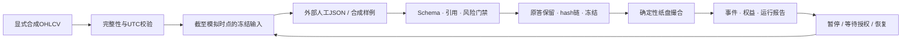

# Crypto Agent — 可审计的 AI 辅助市场研究与模拟交易系统

可审计的受监督AI研究与模拟交易系统：**安全公开候选版**。

本仓库展示数据校验、证据引用、决策冻结、风险门禁、确定性撮合与恢复能力。代码从已有研究系统中白名单提取并适配，公开版不附带原研究数据、策略、模型回答或账户信息。

**默认完全离线。所有行情和模型回答均为合成fixture。Demo不执行实时AI推理，不证明策略收益，不是完全自主研究Agent，不连接交易所账户。**

## 快速运行

Python 3.10+。在仓库根目录使用独立环境；安装依赖需要常规Python包源访问，安装后运行与测试不需要网络。

Windows PowerShell：

```powershell
py -m venv .venv
.\.venv\Scripts\python.exe -m pip install .
.\.venv\Scripts\python.exe -m auditable_research demo --run-dir runs/first-demo
.\.venv\Scripts\python.exe -m auditable_research status --run-dir runs/first-demo
.\.venv\Scripts\python.exe -m unittest discover -s tests -v
```

Linux/macOS：

```bash
python3 -m venv .venv
.venv/bin/python -m pip install .
.venv/bin/python -m auditable_research demo --run-dir runs/first-demo
.venv/bin/python -m unittest discover -s tests -v
```

运行目录必须是新的；同名目录会拒绝覆盖。重复演示时换一个新目录，不必删除既有记录。也可使用安装后的 `research-demo` 命令。

打开 `runs/first-demo/report.json` 查看结构化结果。演示会生成合成行情、冻结输入包、导入明确标记的样例回答、模拟限价成交、记录观察事件与强制重判，并在等待新决策期间执行既有止损，然后导入一个合成no_trade回答。**演示成交不是AI交易表现；停止与恢复也没有调用模型。**

## 可以实际检查什么

| 能力 | 本公开版的实际范围 |
|---|---|
| 行情完整性 | 合成15m OHLCV的连续性、重复、价格关系、UTC边界与有限数校验 |
| 多周期输入 | 从可见前缀聚合1h/4h/1d，仅输出已收盘K线 |
| 外部回答导入 | JSON Schema、输入hash绑定、证据ID、周期和明确数量的校验 |
| 来源与冻结 | 原始回答字节保留、SHA256、只增写日志、配置与代码指纹 |
| 风险门禁 | 固定数量、成本计入风险、单仓位、资金约束；超限拒绝，禁止静默缩量 |
| 模拟订单 | 合成现货long/no_trade及合成合约long/short/no_trade；limit/stop/next_open |
| 风险事件 | mandatory阻断新委托，observation去重；原冻结止损止盈继续执行 |
| 恢复 | 新进程校验链与输入后重载；手动暂停/恢复；锁冲突或损坏安全停止 |
| 统计 | 模拟成交、毛净损益、固定成本敏感性与收盘权益回撤 |

完整边界见[能力清单](docs/CAPABILITIES.md)、[安全与威胁模型](docs/SECURITY.md)。

## 手动工作流接口

```powershell
research-demo start --run-dir runs/manual --config config.example.json
research-demo packet --run-dir runs/manual
research-demo import --run-dir runs/manual --answer answer.json
research-demo advance --run-dir runs/manual --bars 1
research-demo pause --run-dir runs/manual
research-demo status --run-dir runs/manual
research-demo resume --run-dir runs/manual
research-demo report --run-dir runs/manual
```

`packet` 是提供给外部决策者的因果输入；`answer.json` 须符合包内 `answer_schema.json` 并绑定当前请求。`demo` 自动创建的样例文件可用于学习格式，不能伪装成人工或真实模型回答。公开版只接受合成DEMOUSD数据，不提供行情或模型网络客户端。

`pause` 暂停推进，不表示价格停止变化。`resume` 后必须从连续的下一根合成K线补处理；等待mandatory重判时，有持仓可继续 `advance` 执行原保护单，空仓则保持等待。没有新合法回答不能伪造新决策。锁文件在进程异常退出后可能保留：此时安全停止，人工核实进程和日志，程序不会自动删除不明锁。

## 架构与验证



测试与安装验收见 [验证记录](docs/VERIFICATION.md)。[录屏脚本](docs/DEMO_SCRIPT.md)给出约3分钟展示步骤；[招聘展示要点](docs/PORTFOLIO.md)说明可以有证据地陈述的工程能力。

## 重要限制

- SHA256日志用于发现意外篡改，不是签名、防恶意重写或操作系统读取隔离。
- 撮合不知道K线内真实先后：双触价优先不利止损，有歧义的入场当根有利止盈延后；mandatory与入场同根时保守撤单。
- 固定手续费、滑点、资金费是**演示参数**，不代表任何账户费率。资金费仅为固定参数的8h开盘代理，不含真实资金费历史。
- 跳空可能超出计划风险；没有流动性、清算或生产级交易所精度建模。
- 没有自动订阅模型调用、模型网页操作、无人值守实盘或正式OOS收益证明。
- 公开候选代码与私有运行系统相互独立；升级代码会拒绝直接继续旧代码指纹的演示运行，应使用新版本目录。

## English summary

An offline engineering showcase for an **Auditable Supervised AI Research & Paper-Trading System**. It adapts validated research infrastructure into a small reproducible package: causal multi-timeframe evidence, immutable input/answer bindings, explicit risk admission, conservative paper execution, event-driven waiting, and restart verification.

All demo prices and answers are synthetic. There is **no live AI inference, paid model call, real account, private research content, autonomous research claim or profitability claim**. The public candidate intentionally excludes market/model network adapters and proprietary knowledge. See the verification record for the exact tested scope.

## 项目负责人贡献与AI辅助开发

项目负责人基于自己的市场研究需求发起并持续主导项目，参与需求定义、研究方法、功能取舍、实验设计、错误分析、结果验收及迭代决策。大量工程实现借助Codex等AI编程工具完成；本项目不声称负责人独立手写全部代码或已掌握每一项技术。

这些工作是一系列有记录的需求、实现、失败修复和验收迭代，而非一次提示词自动生成完整产品。候选代码仅展示可直接核验的通用工程机制；未公开的研究结果不能作为本版能力证据。

## 许可证与发布状态

所有者已选择MIT License，版权署名为 `Copyright (c) 2026 W1321628614-ops`，完整文本见[LICENSE](LICENSE)。第三方依赖保持各自许可，详见[THIRD_PARTY_NOTICES.md](THIRD_PARTY_NOTICES.md)。MIT仅适用于所有者有权授权的本候选内容，不开放任何未包含的私有研究知识、策略、数据或模型回答。

尚未创建远程仓库、添加remote、推送或公开发布。最终审批状态见[本轮验收报告](docs/FINAL_REVIEW_zh.md)。
